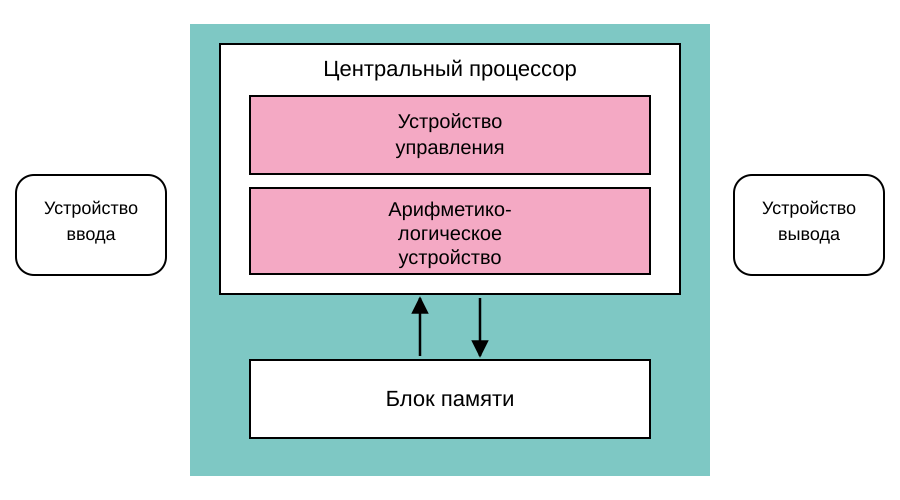
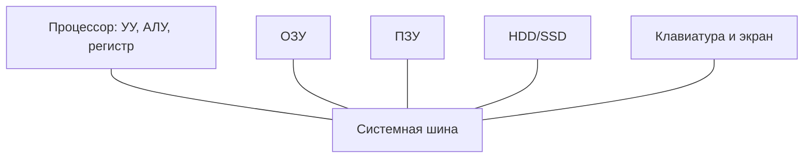
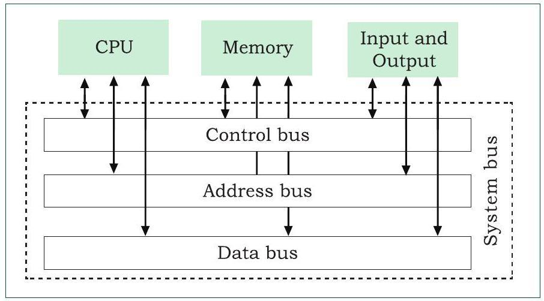

# Лекция 6. Архитектура персонального компьютера

## Цели занятия

После лекции вы умеете:

1. На ленте адресов $0 \ldots 7$ показать четыре принципа фон Неймана: команда и число — двоичные коды; другая последовательность команд — другая задача; адрес в команде выбирает ячейку; команды и числа лежат в одном ОЗУ.
2. Назвать четыре узких места: скорость обмена с памятью, последовательное выполнение команд, общая память команд и данных, предел частоты одного процессора. Для каждого назвать хотя бы одно решение из конспекта.
3. Назвать в процессоре устройство управления, АЛУ и регистр и перечислить цикл: выборка, декодирование, выполнение.
4. На рисунке шины различить шину адреса, шину данных и шину управления. По ширине $n$ сказать, сколько бит едет за раз и сколько адресов дают $n$ линий. Для 64 бит и $100$ МГц при одном слове за такт получить $8 \times 10^{8}$ байт в секунду.
5. Сказать, зачем ПЗУ, HDD/SSD, клавиатура и экран: первая команда при пустом ОЗУ, хранение без питания с выполнением из ОЗУ, ввод чисел и вывод результата.

---

## Принципы фон Неймана

- **Двоичный код.** Команды и числа записаны кодами из нулей и единиц. В памяти команда — такой же код, как число.
- **Программируемость.** Задачу задаёт последовательность команд, процессор один и тот же. Другая последовательность — другая задача.
- **Адресность.** Память собрана из пронумерованных ячеек. Команда выбирает ячейку по её адресу.
- **Хранение программ в памяти.** Команды и числа лежат в одном блоке памяти. У команды есть адрес, как у числа.

---

## 0. Адреса

Программа — тоже код в ячейках. Процессор читает эти ячейки и выполняет команды.

У ячейки есть номер. Номер называется адресом. По адресу процессор находит ячейку и берёт код, который в ней записан.

Операции над кодами делает арифметико-логическое устройство, коротко АЛУ (ALU).

---

## 1. Лента

Память прогона — лента ячеек. Пока компьютер включён, эту ленту держит оперативная память, коротко ОЗУ (RAM).

| Адрес | Содержимое | Роль |
|---|---|---|
| 0 | `ВЗЯТЬ 4` | команда |
| 1 | `СЛОЖИТЬ 5` | команда |
| 2 | `ЗАПИСАТЬ 6` | команда |
| 3 | `СТОП` | команда |
| 4 | 2 | число |
| 5 | 3 | число |
| 6 | 0 | сюда запишется результат |
| 7 | — | программа эту ячейку не читает |

Ячейка 7 показывает, что лента длиннее этой программы. Программа её не читает и не пишет.

В ячейке 0 лежит команда `ВЗЯТЬ 4`, в ячейке 4 — число 2. Оба содержимых — двоичные коды. В таблице команда написана словом, чтобы её можно было прочитать. В ячейке на месте слова стоит код из нулей и единиц, того же рода, что код числа. Раскладку «какие биты означают `ВЗЯТЬ`» - это принцип двоичного кода.

Ячейки 0…3 и ячейки 4…6 — одна лента одного ОЗУ. Команда хранится в памяти вместе с числами, и у команды есть адрес. Это принцип хранения программ в памяти.

### Гарвардская архитектура

В гарвардской архитектуре память команд и память данных разделены. Следующую команду процессор берёт из памяти команд, а число читает из памяти данных. Запись результата попадает в память данных и команду не заменяет: адреса среди чисел у `СЛОЖИТЬ 5` нет. В нашем ОЗУ адрес есть, это ячейка 1. Так устроена машина фон Неймана: команды и числа лежат в одной памяти.

### Узкие места архитектуры фон Неймана и способы их решения

#### Скорость обмена между процессором и памятью

Процессор готов взять следующую команду раньше, чем память успевает отдать код. Пока из ячейки 0 читается `ВЗЯТЬ 4`, число 2 из ячейки 4 ещё ждёт. Путь между процессором и блоком памяти один.

Решения:

- **Кэш-память (L1, L2, L3).** Рядом с процессором держат маленькую быструю копию ячеек. L1 ближе всех и меньше всех, L3 дальше и больше. Повторное чтение той же ячейки идёт из кэша, а не из ОЗУ.
- **Предварительная выборка данных (Prefetching).** Память приносит следующие ячейки до того, как команда их попросила.
- **Контроллеры памяти.** Отдельная схема принимает запросы процессора и ведёт обмен с микросхемами памяти.
- **Увеличение пропускной способности памяти.** За одно обращение по пути едет больше бит, и микросхемы отвечают чаще.
- **Параллельные каналы доступа к памяти.** Несколько путей работают сразу, а не один за другим.

#### Последовательное выполнение команд

Устройство управления заканчивает одну команду и только потом берёт следующую. Пока `СЛОЖИТЬ 5` считается в АЛУ, `ЗАПИСАТЬ 6` ждёт.

Решения:

- **Конвейерная обработка (Pipelining).** Следующая команда начинает выборку, пока предыдущая ещё на шаге выполнения. Три шага цикла идут сразу на разных командах.
- **Суперскалярная архитектура.** Процессор начинает несколько команд за один такт, если им не нужна одна и та же ячейка.
- **Внеочередное выполнение команд (Out-of-Order Execution).** Команда, у которой данные уже есть, выполняется раньше той, которая ещё ждёт память.
- **Предсказание переходов (Branch Prediction).** Перед условным переходом процессор заранее идёт по более вероятной ветке. Если ветка угадана, ждать решения не приходится.

#### Общая память для команд и данных

Команды и числа лежат в одном ОЗУ и едут по одному пути. Чтение команды и чтение числа одновременно не идут. Запись в ячейку 1 подменяет `СЛОЖИТЬ 5`.

Решения:

- **Гарвардская архитектура.** Отдельная память и отдельные каналы для команд и для данных.
- **Модифицированная гарвардская архитектура.** ОЗУ общее, а кэши команд и данных разделены. Команда и число на уровне кэша не стоят в одной очереди.
- **Независимые контроллеры и каналы доступа.** Запрос за командой и запрос за числом обслуживают разные схемы.

#### Ограниченная производительность одного процессора

Увеличивать частоту процессора бесконечно нельзя. При росте частоты увеличиваются энергопотребление и тепловыделение.

Решения:

- **Многоядерные процессоры.** В одном корпусе несколько ядер. Каждое ведёт свой цикл команд.
- **Многопоточность (Multithreading).** Одно ядро держит несколько последовательностей команд и переключается на другую, когда текущая ждёт память.
- **Параллельные вычисления.** Задачу делят на части, и эти части считаются одновременно.
- **GPU (графические процессоры).** Отдельный процессор с большим числом простых ядер. На однотипных операциях над многими числами сразу он занят делом там, где одно ядро центрального процессора берёт числа по одному.

#### Сводная таблица

| Проблема | Решение |
|---|---|
| Медленная память относительно CPU | Кэш L1/L2/L3 |
| Ограниченная пропускная способность | Быстрая память, многоканальный доступ |
| Последовательная обработка | Конвейеризация |
| Зависимость команд друг от друга | Out-of-Order Execution |
| Простои при условных переходах | Branch Prediction |
| Общий канал команд и данных | Гарвардская архитектура |
| Ограничения одного ядра | Многоядерность |
| Высокая стоимость перемещения данных | Near-Memory Computing |
| Универсальный CPU неэффективен для отдельных задач | GPU, TPU, NPU |

Near-Memory Computing переносит счёт ближе к микросхемам памяти: данные меньше едут до центрального процессора. TPU и NPU — отдельные процессоры под тензорные операции и под нейросети, рядом с GPU.

---

## 2. Процессор

Персональный компьютер в этой лекции — процессор, память и устройства на одной системной шине. Её же называют магистралью (bus).

Процессор выполняет команды. В примере используются три его части.

Устройство управления, коротко УУ (CU), хранит адрес следующей команды и разбирает прочитанный код. Сначала этот адрес равен 0.

Регистр (аккумулятор) хранит одно текущее число. Регистр в примере один.

АЛУ считает. В этом прогоне оно складывает коды.

Принцип работы процессора — цикл из трёх шагов: выборка команды, декодирование, выполнение. Пока команда не велит остановиться, УУ увеличивает адрес следующей команды на 1 и берёт команду уже оттуда.

---

## 3. Системная шина

На рисунке системная шина (System bus) собрана из трёх шин. Шина управления (Control bus) несёт признак действия, чтение или запись. Шина адреса (Address bus) несёт номер ячейки. Шина данных (Data bus) несёт сам код. К ним подключены процессор (CPU), память (Memory) и устройства ввода-вывода (Input and Output).

Ширина и частота говорят, сколько кода шина успевает перенести.

**Ширина** — число линий, по которым код едет одновременно. Шина данных шириной $n$ бит переносит $n$ бит за одно обращение. При 64 линиях это 8 байт. Шина адреса шириной $n$ бит различает $2^{n}$ адресов. 32 линии адреса называют $2^{32}$ ячеек.

**Частота** — сколько таких обращений проходит за секунду. Частота $100$ МГц означает $10^{8}$ передач в секунду.

Если за один такт по шине передаётся один блок данных (равный её разрядности), то пропускная способность равна произведению ширины шины на её частоту. Для 64 бит и $100$ МГц это $6{,}4 \times 10^{9}$ бит в секунду, или $8 \times 10^{8}$ байт в секунду.

---

## 4. ПЗУ, диск, ввод и вывод

Прогон шёл по ОЗУ. На той же шине у персонального компьютера есть и другие блоки.

**ПЗУ** (ROM) — постоянное запоминающее устройство. При включении ОЗУ ещё не держит ленту команд. Первую команду процессор берёт из ПЗУ. ПЗУ хранит эту программу и без питания.

**HDD и SSD** — память вне ленты прогона. Она держит данные без питания. Следующую команду процессор берёт из ОЗУ, поэтому программу с диска сначала копируют в ОЗУ. Диск медленнее регистра: регистр стоит в процессоре, диск — снаружи.

**Клавиатура и экран** — устройства ввода и вывода. Числа 2 и 3 к началу прогона уже лежали в ячейках. Попасть туда они могли с клавиатуры. Число 5 из ячейки 6 может уйти на экран. Процессор и здесь выполняет команды.

---

## 5. Та же машина и Python

Строка `s = a + b` делает ту же работу, что лента: взять два числа, сложить, записать результат. Процессор крутит тот же цикл «выборка → декодирование → выполнение». Команд больше, чем четыре, и одна строка Python разворачивается в много таких команд. Интерпретатор Python — тоже программа в памяти. Его команды и данные лежат в ОЗУ, как `ВЗЯТЬ 4` и число 2.

---

## 6. Итог

Лента $0 \ldots 7$ хранит команды и числа в одном ОЗУ. Это машина фон Неймана: двоичный код, адресность, хранение программ в памяти, программируемость. Гарвардская архитектура делит память команд и память данных, поэтому запись числа команду не подменяет.

У этой машины четыре узких места. Память не успевает за процессором: рядом держат кэш. Команды идут по одной: следующую начинают, пока предыдущая ещё выполняется. Команда и число делят один путь: у гарвардской машины пути разные. Частоту одного процессора не поднимают без конца: растут энергопотребление и тепло, задачу делят между ядрами.

Процессор состоит из устройства управления, АЛУ и регистра. Цикл — выборка, декодирование, выполнение. Системная шина несёт номер ячейки, код и признак чтения или записи. Ширина — сколько бит едет сразу, частота — сколько передач в секунду. ПЗУ даёт первую команду при пустом ОЗУ. Диск хранит данные без питания, выполнение идёт из ОЗУ. Клавиатура и экран вводят числа и выводят результат. Строка `s = a + b` — тот же цикл, команд больше.

---

## Справочник

### Лента

| Адрес | 0 | 1 | 2 | 3 | 4 | 5 | 6 | 7 |
|---|---|---|---|---|---|---|---|---|
| Содержимое | `ВЗЯТЬ 4` | `СЛОЖИТЬ 5` | `ЗАПИСАТЬ 6` | `СТОП` | 2 | 3 | 0 | — |

Ячейки 0…3 — команды, ячейки 4…6 — числа, одно ОЗУ. Ячейку 7 программа не читает.

### Принципы

| Принцип | Где виден |
|---|---|
| Двоичный код | `ВЗЯТЬ 4` и число 2 — коды в ячейках |
| Хранение программ в памяти | ячейки 0…3 и 4…6 лежат в одном ОЗУ |
| Адресность | в команде `ВЗЯТЬ 4` число 4 — адрес ячейки |
| Программируемость | другую задачу задаёт другая последовательность команд, процессор тот же |

### Узкие места

| Узкое место | Одно решение |
|---|---|
| Скорость обмена с памятью | кэш L1, L2, L3 |
| Последовательное выполнение команд | конвейер |
| Общая память команд и данных | гарвардская архитектура |
| Предел частоты одного процессора | несколько ядер |

### Шина

| | |
|---|---|
| Шина адреса | номер ячейки |
| Шина данных | код |
| Шина управления | чтение или запись |
| 64 линии данных | 8 байт за обращение |
| 32 линии адреса | $2^{32}$ адресов |
| $100$ МГц | $10^{8}$ передач в секунду |
| 64 бита, $100$ МГц, одно слово за такт | $8 \times 10^{8}$ байт в секунду |

### Блоки

| Блок | Роль в лекции |
|---|---|
| УУ | хранит адрес следующей команды и разбирает код |
| АЛУ | считает |
| Регистр | хранит одно текущее число |
| ОЗУ | лента адресов 0…7, пока компьютер включён |
| ПЗУ | первая команда, когда ОЗУ ещё пустое |
| HDD/SSD | хранит данные без питания; команду выполняют уже из ОЗУ |
| Клавиатура и экран | числа входят в ячейки и результат выходит |

---

## Упражнения для самоконтроля

**1. Лента.** Где на ленте $0 \ldots 7$ видно, что команда и число лежат в одной памяти?

**Ответ.** Команды лежат в ячейках 0…3, числа — в ячейках 4…6. Это одно ОЗУ. У `СЛОЖИТЬ 5` есть адрес: ячейка 1.

**2. Ширина.** Шина данных — 64 линии, шина адреса — 32 линии. Сколько байт за одно обращение и сколько адресов?

**Ответ.** 8 байт. $2^{32}$ адресов.

**3. Частота.** Те же 64 линии, частота $100$ МГц, за такт уходит одно слово. Сколько байт в секунду?

**Ответ.** $64 \times 10^{8} = 6{,}4 \times 10^{9}$ бит в секунду. Это $8 \times 10^{8}$ байт в секунду.

**4. Узкое место.** Команды выполняются строго по одной. Как называется это узкое место и какое решение начинает следующую команду, пока предыдущая ещё выполняется?

**Ответ.** Последовательное выполнение команд. Конвейерная обработка: выборка следующей команды идёт, пока предыдущая ещё на шаге выполнения.

**5. Включение.** ОЗУ пустое. Откуда процессор берёт первую команду?

**Ответ.** Из ПЗУ.

---

## Контрольные вопросы

1. Чем программируемость отличается от хранения программы в памяти на этой ленте?
2. Что несут три шины при чтении ячейки и при записи в ячейку?
3. Что у гарвардской архитектуры разделено и почему запись числа не подменяет команду?
4. Почему следующую команду процессор берёт из ОЗУ, а не сразу с HDD или SSD?
5. Почему `s = a + b` — тот же цикл, что `ВЗЯТЬ`, `СЛОЖИТЬ`, `ЗАПИСАТЬ`?

### Ответы для самопроверки

1. Хранение программы в памяти: команды и числа лежат в одном ОЗУ, у `СЛОЖИТЬ 5` есть адрес. Программируемость: другая последовательность в этих ячейках — другая задача при том же процессоре. Ячейка 1 со `СТОП` вместо `СЛОЖИТЬ 5` останавливает процессор после `ВЗЯТЬ 4`.
2. При чтении, как на `СЛОЖИТЬ 5`: адрес ячейки, код из ячейки, «чтение». При записи, как на `ЗАПИСАТЬ 6`: адрес ячейки, число из регистра, «запись». Выборка команды — тоже чтение по тем же линиям.
3. Разделены память команд и память данных. Запись результата попадает в память данных, команда остаётся в памяти команд.
4. Следующую команду процессор выбирает из ОЗУ. Программу с диска сначала копируют в ОЗУ. Диск медленнее регистра.
5. Та же работа: взять два числа, сложить, записать результат. Цикл тот же, команд больше. Интерпретатор Python сам лежит в ОЗУ.

---

## Материалы для самостоятельного изучения

- [Архитектура фон Неймана](https://ru.wikipedia.org/wiki/Архитектура_фон_Неймана). Четыре принципа ленты из этой лекции.
- [Гарвардская архитектура](https://ru.wikipedia.org/wiki/Гарвардская_архитектура). Раздельные память команд и память данных.
- [Системная шина](https://ru.wikipedia.org/wiki/Системная_шина). Адрес, данные и управление между блоками.

### Первоисточники

- [Preliminary Discussion of the Logical Design of an Electronic Computing Instrument](https://www.ias.edu/sites/default/files/library/Prelim_Disc_Logical_Design.pdf). Беркс, Голдстайн, фон Нейман, 1946. Одна память для команд и чисел, двоичная запись, аккумулятор, обычный переход к следующей ячейке.
- [First Draft of a Report on the EDVAC](https://archive.org/details/vnedvac). Фон Нейман, 1945. Управление получает команду из памяти, распознаёт и исполняет. С внешнего носителя сведения сначала попадают в память.
- [IBM Personal Computer Technical Reference, август 1981](https://bitsavers.org/pdf/ibm/pc/pc/6025008_PC_Technical_Reference_Aug81.pdf). Канал персонального компьютера: 8 линий данных, 20 линий адреса, линии чтения и записи.
