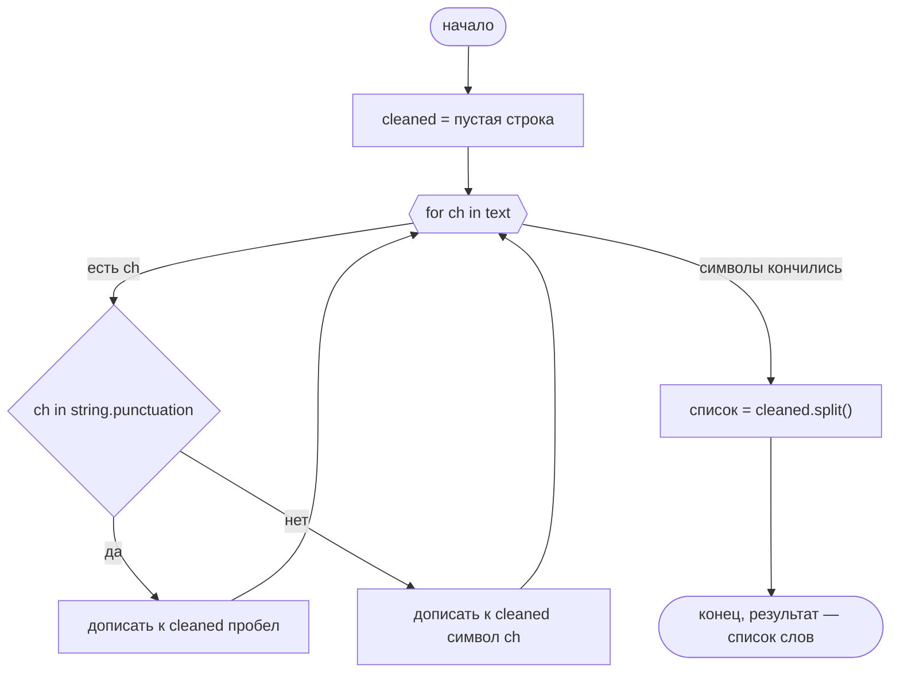
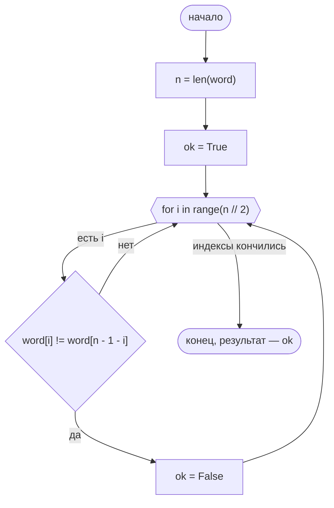
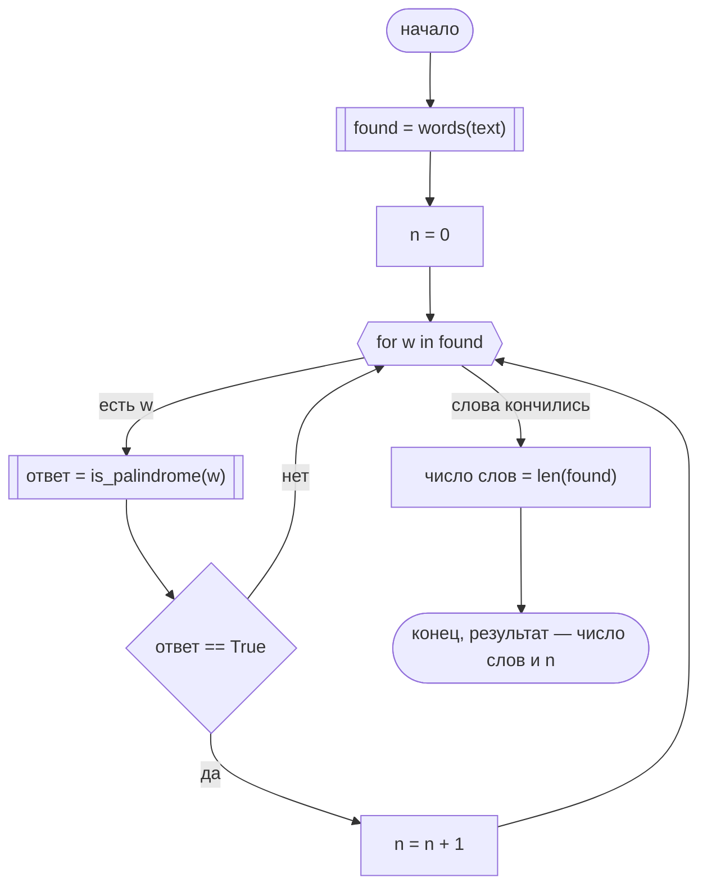

# Сколько слов в тексте и сколько в нём палиндромов

Три схемы, по одной на функцию. У каждой своё начало и свой конец.

Фигуры те же, что на лекции о блок-схемах, плюс две для функций. Овал — начало и конец. Прямоугольник — действие. Ромб — условие, стрелки подписаны «да» и «нет». Шестиугольник — цикл `for`. Прямоугольник с двойными боковыми сторонами — вызов функции.

Пример строки: `'казак, топот дом!'`. Слова: `казак`, `топот`, `дом`. Палиндромов два. `summary` возвращает `(3, 2)`.

## `words`

Знак из `string.punctuation` заменяется пробелом. Остальные символы дописываются как есть. После цикла строка делится через `split`.

## `is_palindrome`

Регистр тот же. Середина слова в цикл не входит: у `'казак'` сравниваются пары `(0, 4)` и `(1, 3)`.

## `summary`

Подсчёт двух значений. Разбиение на слова и проверка палиндрома сюда не вписаны: на схеме это вызовы.

